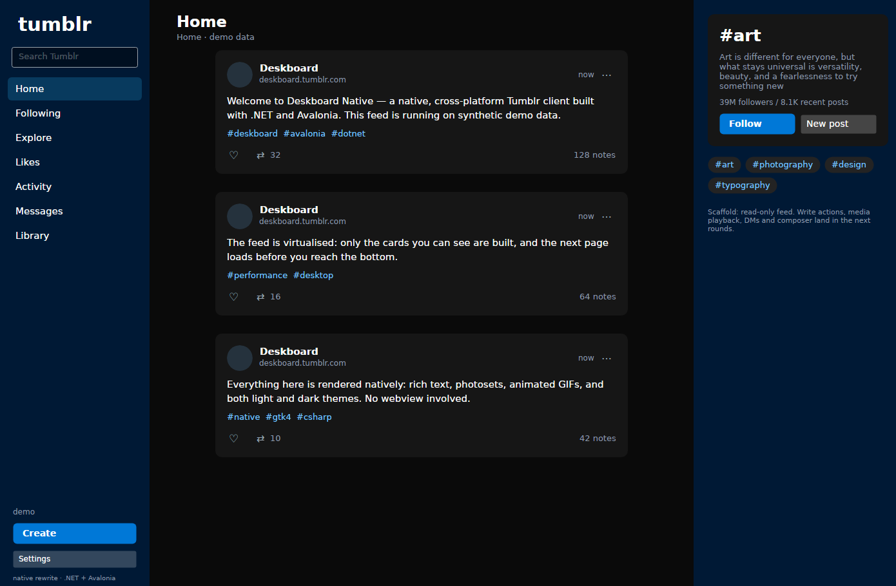
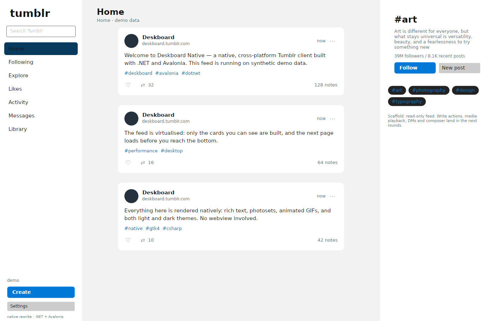
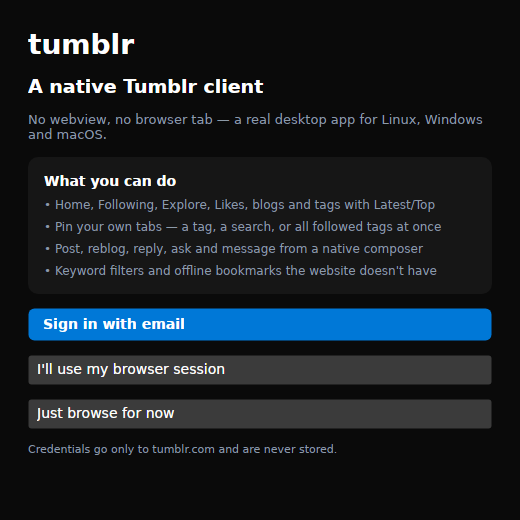
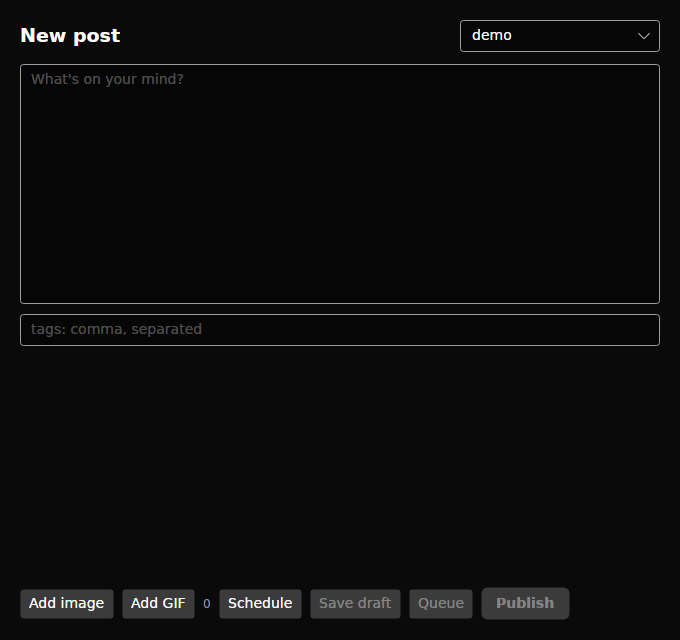
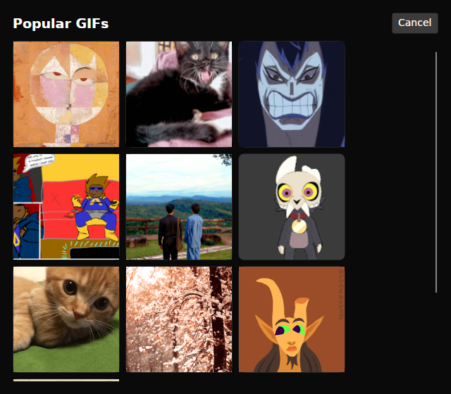

<div align="center">

# Deskboard Native

**The cross-platform rewrite of Deskboard — a native Tumblr client for Windows, macOS and Linux.**

</div>

> **Status: early scaffold.** This repository is the *start* of the cross-platform
> rewrite. The working Linux proof of concept lives in
> [`Wrecht-Dev/deskboard`](https://github.com/Wrecht-Dev/deskboard) and documents
> Tumblr's API surface in depth; this repository will grow into a client that runs
> on all three desktop platforms.

## Why a rewrite

The proof of concept was Python + GTK, which is Linux-only by construction. This
rewrite targets **one codebase for Windows, macOS and Linux**, keeping the things
that made the PoC good (native performance, no webview, Tumblr-faithful UI) while
dropping the platform lock-in.

## Stack: C# / .NET 10 + Avalonia

Chosen after comparing the realistic cross-platform desktop stacks:

| Stack | Verdict |
|---|---|
| **C# + Avalonia** ✅ | Real native window chrome on all three OSes, mature virtualised lists for infinite feeds, async/await networking, sane media/text story, single language for core + UI, excellent tooling. |
| Flutter (Dart) | Strong UI velocity and media ecosystem, but custom-rendered UI (less platform-native), heavier toolchain; good runner-up. |
| Rust + Slint/Iced | Best raw performance and binary size, weakest ecosystem for video/audio/rich text — too much cost for this app. |
| Kotlin/Compose Multiplatform | Desktop story is JVM-heavy; weaker Windows/macOS packaging. |

Full decision record: [`docs/REWRITE.md`](docs/REWRITE.md).

## Custom features the web doesn't have

- **Pinned tabs**: pin any tag, search, or *all followed tags* as its own tab,
  each remembering its own **Latest / Top** sort. Add with **＋**, unpin with one click.
- A ready-made **"Your tags"** tab aggregates every tag you follow into one feed.
- **Keyword filters**: mute words/phrases across feeds and pinned tabs, with a
  "N posts hidden — Show hidden" banner. Managed in Settings.
- **Local bookmarks**: save any post with ☆; stored on disk, works offline,
  independent of likes. Browse them under **Bookmarks**.

## What works right now

**Read**
- Home (For you), Following, Explore, Likes, blog pages, tag pages with **Latest/Top**.
- Search across posts, blogs and communities; notifications/Activity; direct messages
  (Inbox + Requests, threads, send); Inbox / Drafts / Queue library.
- Post permalink with the real notes breakdown (likes, reblogs, replies) and pagination.

**Write**
- Like/unlike (optimistic, reverting), reblog with all three web modes (comment +
  tags, post only, scheduled), follow/unfollow, reply, ask (with anonymous toggle),
  submit to blogs that accept submissions, edit your own posts, DM send and
  request accept, mute/block/report/delete with confirmations, notes moderation.

**Composer**
- NPF text + tags, image upload, publish / queue / draft / schedule, edit mode.

**Presentation**
- Three-column Tumblr shell, virtualised feed with infinite scroll, photoset grids,
  **animated GIF playback**, video/audio badges, rich text (headings, quotes, lists,
  bold/italic/strike/links), light and dark themes.

### Screenshots

| Dark | Light |
|---|---|
|  |  |

| First run | Composer | GIF library |
|---|---|---|
|  |  |  |

Both screenshots use **synthetic demo data** (`DESKBOARD_DEMO=1`) — no real
account content appears anywhere in this repository.

### Known limitations

- **Inline video/audio decoding** is not wired; badges hand the media to your
  system player instead.
- Write actions are **wired and API/unit-tested but never fired against a real
  account** except an authorised like/unlike test. That is deliberate.
- Torn between fidelity and risk: no Premium/Blaze purchases, domains,
  communities, 2FA or login recovery.
- Visual parity is close but not pixel-identical: the web uses the proprietary
  *Favorit* typeface, this build falls back to Inter.


## Install (one line)

**Linux / macOS**
```bash
curl -fsSL https://raw.githubusercontent.com/Wrecht-Dev/deskboard-native/main/scripts/install.sh | bash
```

**Windows (PowerShell)**
```powershell
irm https://raw.githubusercontent.com/Wrecht-Dev/deskboard-native/main/scripts/install.ps1 | iex
```

Every release ships **self-contained** builds for Linux x64, Windows x64,
macOS Apple Silicon and macOS Intel — no .NET runtime required. Releases are
produced by CI on every `v*` tag; see [`.github/workflows/release.yml`](.github/workflows/release.yml).
The installers are plain shell/PowerShell you can read before running.

Prefer building it yourself?

```bash
dotnet build Deskboard.sln
dotnet run --project src/Deskboard.App
```

## Build & run

Requires the **.NET 10 SDK**.

```bash
dotnet build
dotnet run --project src/Deskboard.App
```

Session cookies, in order of precedence:

1. `DESKBOARD_COOKIES` — a JSON dictionary of cookie name → value.
2. `~/.local/share/deskboard/cookies.json` — the Linux PoC's store (reused as-is).
3. No session → public/Explore-only content.

## Layout

```
src/Deskboard.Core/   API client, models, cookie loading   (no UI dependency)
src/Deskboard.App/    Avalonia UI: views, view models, theme
docs/API.md           the mapped Tumblr API surface
docs/REWRITE.md       stack decision + design reference
docs/reference/       real Tumblr UI screenshots used as design reference
```

## Roadmap

1. **Read everything** — notifications, messages/inbox, blog pages, tags (Latest/Top),
   search, notes. (PoC proves every endpoint; port in progress.)
2. **Write actions** — like, reblog (text/post-only/scheduled), follow, reply, ask, DM.
3. **Composer** — NPF text/quote/link/photo, uploads, publish/queue/draft/schedule.
4. **Platform polish** — native menus, tray, Windows/macOS packaging, auto-update.

## Security

No credentials are committed. Session cookies live only in your local store, the
public web token is fetched at first launch and cached `0600`, and the app talks
only to `www.tumblr.com` and Tumblr's CDNs. See the PoC's `SECURITY.md`.

## License

MIT.
