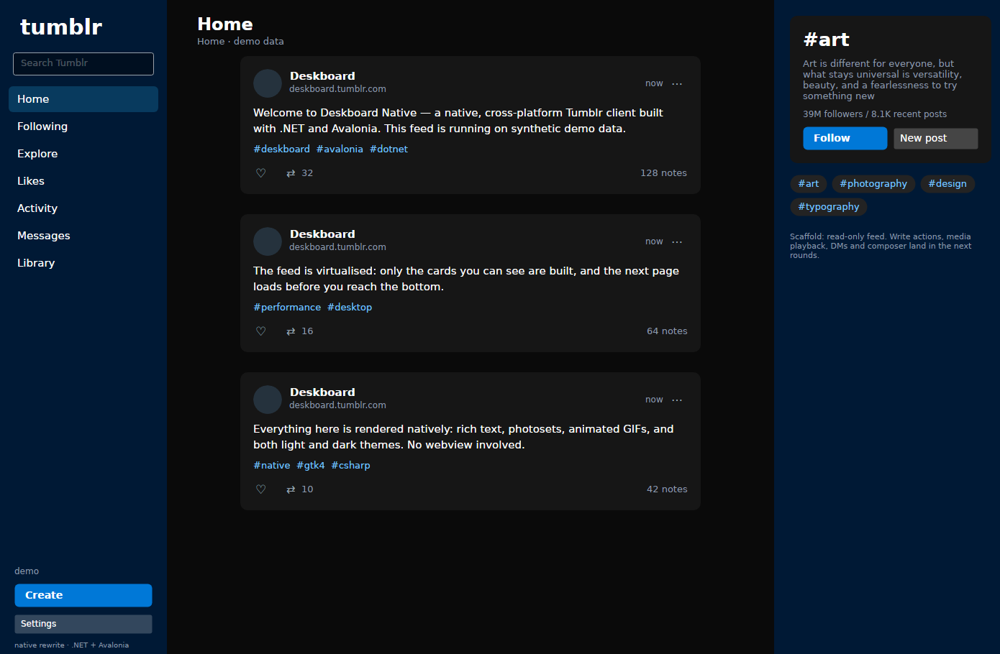
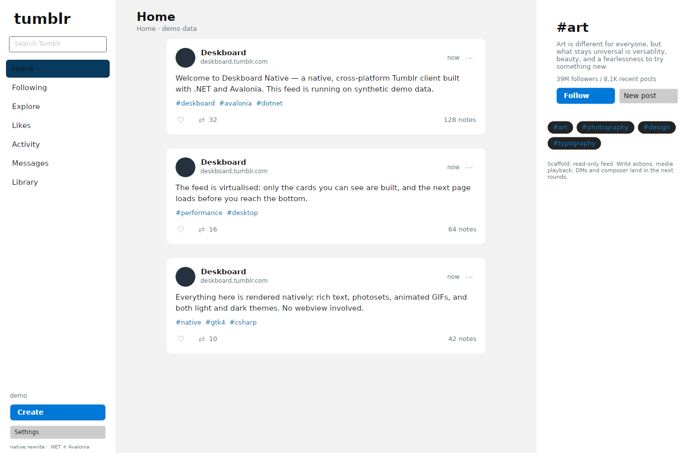
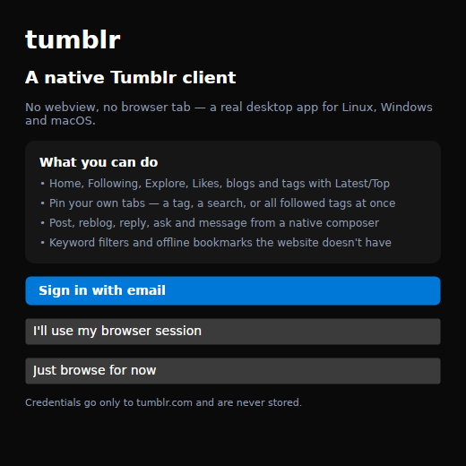
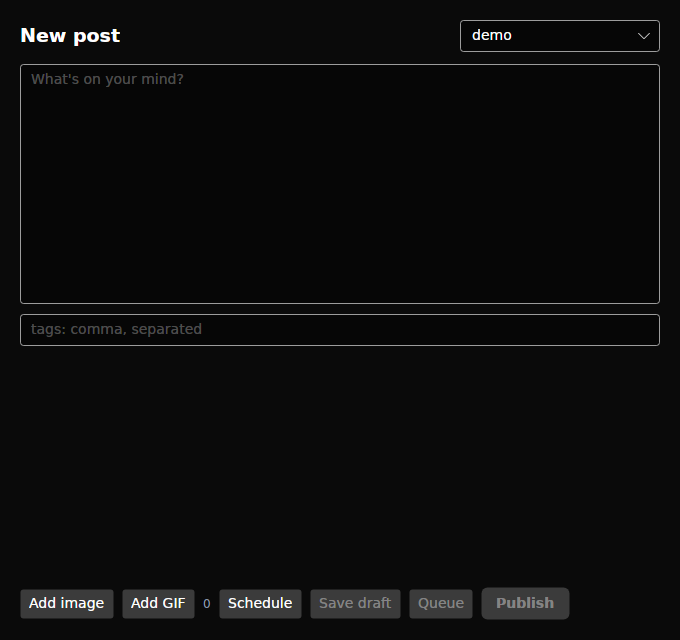
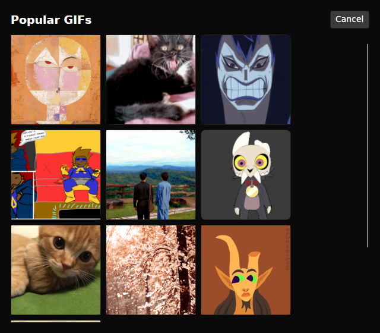

<div align="center">

# Deskboard Native

**The cross-platform rewrite of Deskboard — a native Tumblr client for Windows, macOS and Linux.**

</div>

Deskboard Native is an unofficial Tumblr desktop client built with C#, .NET 10
and Avalonia. It renders feeds, post details and the composer without embedding
a browser. The app is in beta. See [platform coverage and known gaps](docs/BETA.md).

## Custom features the web doesn't have

- **Pinned tabs**: pin any tag, search, or *all followed tags* as its own tab,
  with **Latest / Top** sorting for tag feeds. Add with **＋**, unpin with one click.
- A ready-made **"Your tags"** tab aggregates every tag you follow into one feed.
- **Keyword filters**: mute words/phrases across feeds and pinned tabs, with a
  "N posts hidden — Show hidden" banner. Managed in Settings.
- **Hide mature posts** (best-effort): hides blogs Tumblr flags as 18+. Tumblr
  doesn't flag many explicit blogs, so keyword filters are the reliable control.
- **Local bookmarks**: save any post with ☆; stored on disk, works offline,
  independent of likes. Browse them under **Bookmarks**.

## What works right now

**Read**
- Home (For you), Following, Explore, Likes, blog pages, tag pages with **Latest/Top**.
- Search across posts, blogs and communities; notifications/Activity; direct messages
  (Inbox + Requests, threads, send); Inbox / Drafts / Queue library.
- Post permalink with the real notes breakdown (likes, reblogs, replies) and pagination.

**Write**
- Like/unlike (optimistic, reverting), reblog with all three web modes (comment +
  tags, post only, scheduled), follow/unfollow, reply, ask (with anonymous toggle),
  submit to blogs that accept submissions, edit your own posts, DM send and
  request accept, mute/block/report/delete with confirmations, notes moderation.

**Composer**
- NPF text + tags, image upload, publish / queue / draft / schedule, edit mode.

**Presentation**
- Three-column Tumblr shell, virtualised feed with infinite scroll, photoset grids,
  **animated GIF playback**, video/audio badges, rich text (headings, quotes, lists,
  bold/italic/strike/links), light and dark themes.

### Screenshots

| Dark | Light |
|---|---|
|  |  |

| First run | Composer | GIF library |
|---|---|---|
|  |  |  |

The screenshots use **synthetic demo data** (`DESKBOARD_DEMO=1`) — no real
account content appears anywhere in this repository.

### Desktop visual references

The sample screenshots above show earlier builds. The dashboard uses a centered
post feed with separate navigation and discovery areas. Deskboard keeps its
own colors and collapses the discovery rail in narrower windows.
[Tumblr's Explore screenshot](https://i0.wp.com/help.tumblr.com/wp-content/uploads/2017/01/e666b-screenshot2023-09-29at11.54.05am.png)

Pin a tag or search directly from its feed header. The pinned section keeps
those feeds and Your tags within reach, and the selected sort is highlighted.
[Tumblr's dashboard tab screenshot](https://i0.wp.com/help.tumblr.com/wp-content/uploads/2023/11/de364-dashboard-tabs.png)
[Tumblr's tag page screenshot](https://i0.wp.com/help.tumblr.com/wp-content/uploads/2017/01/7c169-screenshot2023-09-29at12.04.32pm.png)

Post cards group notes, likes, reblogs, and the local bookmark action in one
footer. The filter banner links to filter settings and lets you reveal hidden
posts in the current feed.

### Known limitations

- **Inline video/audio decoding** is not embedded. A LibVLC integration was
  prototyped and reverted because it can crash natively when VLC is absent; the
  badge safely opens your system player instead.
- Write actions are covered by fixtures and unit tests where available. Like/unlike is the write
  flow verified against a real account.
- Community management, purchases, domains and account recovery are outside
  the current beta. The sign-in form supports a Tumblr two-factor code prompt.
- Visual parity is close but not pixel-identical: the web uses the proprietary
  *Favorit* typeface, this build falls back to Inter.


## Install

Download the archive for your platform from the [releases page](https://github.com/Wrecht-Dev/deskboard-native/releases),
or use an installer below.

**Linux / macOS**
```bash
curl -fsSL https://raw.githubusercontent.com/Wrecht-Dev/deskboard-native/main/scripts/install.sh | bash
```

**Windows (PowerShell)**
```powershell
irm https://raw.githubusercontent.com/Wrecht-Dev/deskboard-native/main/scripts/install.ps1 | iex
```

Every release ships **self-contained** builds for Linux x64, Windows x64,
macOS Apple Silicon and macOS Intel — no .NET runtime required. Releases are
produced by CI on every `v*` tag; see [`.github/workflows/release.yml`](.github/workflows/release.yml).
The installers are plain shell/PowerShell you can read before running.

On macOS the installer copies Deskboard.app to `~/Applications`. The bundle is
unsigned. Windows and macOS packages are cross-built, with native launch and
installation still awaiting verification.

## Build and run

Use the **.NET 10 SDK**.

```bash
dotnet build Deskboard.sln -c Release
dotnet test Deskboard.sln -c Release
dotnet run --project src/Deskboard.App
```

Set `DESKBOARD_DEMO=1` to launch with synthetic sample posts.

## Sign in

On first launch, sign in to Tumblr, explicitly import a Firefox session, or open
Explore signed out. Firefox import currently searches Linux profile locations
and requires the `sqlite3` executable. The app stores its session locally and can
reuse a legacy Deskboard session when no native session file exists. An explicit
`DESKBOARD_COOKIES` JSON override takes precedence over local session files.

## Project layout

| Path | Contents |
|---|---|
| `src/Deskboard.Core/` | Tumblr API client, models and session storage |
| `src/Deskboard.App/` | Avalonia views, view models and theme |
| `tests/Deskboard.Tests/` | Automated tests and fixtures |
| [API coverage](docs/API.md) | Mapped Tumblr API surface |
| [Beta verification](docs/BETA.md) | Executed checks and remaining gaps |

## License

MIT.
